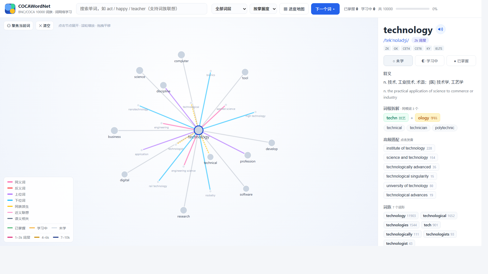

# COCAWordNet 🔥

**以词网络记单词** —— 基于 BNC/COCA 10000 词族表的交互式词网学习应用。

不是按列表背单词，而是把每个单词和它有关系的词（同义词、反义词、同族派生、语义相关词……）连成一张可交互的网络。点一个词，网就往外扩一圈——像滚雪球一样成片地记，而不是孤立地背。



## ✨ 特性

- **词关系网络**：10,000 个词头、158,000+ 条关系边（平均每词 15.8 个相关词），力导向图交互，点击节点无限扩展
  - 同义词 / 反义词 / 上位词 / 下位词（来自 WordNet）
  - 同族派生：act → action, actor, acting（来自 Paul Nation 官方词族表）
  - 语义相关：dog → cat, pet, horse（来自 GloVe 词向量）
  - 七种关系线采用烟花配色，全图 15 色唯一，掌握度颜色不混淆
- **词典信息**：每个词带音标、中文释义、英文释义、考纲标签（四六级/考研/托福/雅思/GRE）
- **美式发音**：真人美音（有道词典接口），离线自动回退浏览器语音合成；快捷键 P
- **词根词缀拆解**：1,369 个词有构词分析（前缀/词根/后缀分段染色 + 中文释义），如 impossible = im-(不) + poss(能够) + ible(可…的)；并给出同根词网（vision → television, advise, supervise…）
- **高频搭配**：9,937 个词（99.4%）有真实语料搭配，如 make → make sure / make up、abject → abject poverty / abject submission，点击即发音。高频词来自 1,700 万词维基语料的 PMI 统计；低频词（6k–10k 层）维基样本里几乎没有证据，改用 Google Books n-gram 补齐
- **掌握度三态**：未学 / 学习中 / 已掌握，节点变色 + 顶部进度条，localStorage 自动保存
- **进度地图**：按 1k–10k 词频层的进度热力图，自动标出短板层，点击直接开刷
- **易混词辨析**：用词表 + 音标自动算出「形近」「音近」的词（effect/affect、than/then、principal/principle、desert/dessert、loose/lose…），词卡里直接列出；点「辨析」并排对比音标与释义，还能做「选词填空」小测（快捷键 C）
- **词性导航**：多义词（如 light 有名/形/动/副四种词性 24 个义项）的释义上方有一排词性标签「名词 n. ×9 / 动词 v. ×6 / …」，点击只看该词性的中英文释义（整组展开不折叠）；该词性没有英文释义时明确提示，不再整块藏掉
- **词根 / 词缀索引**：快捷键 `I`（或顶栏「🧩 词根」）。把词卡里零散的「词根拆解」反过来聚成「一个词根 → 一串同根词」：`-spect-` → inspect / respect / prospect / retrospect，`port` → export / import / transport / report… 共 411 组（词根 279 · 前缀 80 · 后缀 52），按串起的词数排序；可按词根、含义（如搜「搬运」）或单词反查，也能按「词根 / 前缀 / 后缀」分 tab；**词卡里的每个词根段都变成了入口**，点一下直接定位到那一组。全部由已载入词层数据现算，不增加任何数据文件
- **词根串记模式**：在词根索引页点「🧭 开始串记」（或任一组头的「🧭 练」），把 411 组词根当学习路径一组组过——一组同根词排在一起，认得的点 ✓、模糊的点 ◐、忘了的点 ✗，评过的词**写进和复习卡同一条记录**，之后按间隔重复自动排队、也算进学习统计。组间默认「由易到难」（按组内词的词层中位数排，tend / spec / pos / port 这些高频根在前），可切「词数优先」；大组先画前 30 个词；点单词听发音、点 🕸 去词网看它的关系（会话保留，回来接着串）；快捷键 `←` / `→` 切组、`Esc` 退出
- **段落记忆**：把词网里散开的词编进**同一段连贯短文**里读——词卡「段落记忆」区块直接显示这一段（默认展开 9 个词，可展开全部），目标词按关系类型染色（同族派生 / 同义 / 上位 / 下位…），点句子朗读、点词跳回它的词网。更有用的是 **「✎ 挖空练习」（快捷键 `T`）**：段落里的目标词全部挖空，下方给一个词池回填，判分后按「忘了 / 有印象 / 记得」记一次复习，**写进和复习卡同一条 SRS 记录**。背景知识：能凑出「同一义项 ≥7 个关系词」的高频词约 2,504 个（b1 层 529、b2 516、b3 399；到 b10 只剩 45），所以按词层一批批补——**当前已覆盖 1056 个词**（b1 层 529 + b2 层 516，也就是 b1、b2 两层里所有能写的高频词已 100% 写完；b3 有 11 个样板），每段 90–130 词，段落按词层分块载入，`data_net_bNN.js` 放进去即自动生效
- **一键复位视图**：缩放/拖拽迷路时，点视角控件里的 ⤾（或按 `Z`）把缩放/平移一次归零，布局不动
- **学习统计面板**：快捷键 `S`（或顶栏「📊 统计」）打开——总体覆盖率与掌握分布、记忆保持率、连续学习天数、近 14 天复习量柱状图（按「忘了/有印象/记得」分色）、到期复习分布（已到期 / 今天 / 1–3 / 4–7 / 8–30 / 30+ 天）、各词层进度与短板层，逐日记录从 v34 起
- **进度导入导出**：学习进度可一键导出为 JSON 文件备份，换浏览器/换电脑随时恢复
- **跨设备同步（同步码）**：不用账号、不用联网，「进度地图 → ⇄ 跨设备同步」生成一段码，粘到另一台设备即按时间戳合并，两台设备各学各的都不会丢
- **搜索联想**：支持词族成员跳转，搜 government 直达词头 govern（24,000+ 条别名映射）；**也支持直接打中文找词**——输入「政府」「放弃」等释义即列出对应单词（按词频层排序、带匹配义项回显），中文词典索引按需载入，不增加首屏体积
- **可装成 App**：支持「添加到主屏幕」（PWA），拥有独立图标、全屏无浏览器边框运行；Service Worker 预缓存整个词库，**断网也能用**

## 🚀 快速开始

### 方式一：本地直接打开

下载本仓库（`Code ▾` → `Download ZIP`），解压后**双击 `index.html`** 即可，无需安装任何东西。

### 方式二：部署到 GitHub Pages（推荐，手机也能用）

1. Fork 或使用本仓库模板创建你自己的仓库
2. 仓库页 → `Settings` → `Pages` → `Source` 选 `Deploy from a branch`，Branch 选 `main` / `(root)`，保存
3. 一分钟后访问 `https://wei940127.github.io/COCAWordNet/`

也可以用任何静态托管（Vercel / Netlify / Cloudflare Pages），直接导入仓库即可，无需构建。

### 方式三：装到 iPad / iPhone（当作 App 用，推荐）

无需 App Store、无需越狱、无需签名。用 Safari 打开线上地址后「添加到主屏幕」即可，效果等同原生 App：

1. 在 iPad 上用 **Safari**（必须是 Safari，Chrome / 微信内置浏览器不支持添加到主屏幕）打开
     
   `https://wei940127.github.io/COCAWordNet/`
2. 等待首次加载完成（首屏只需约 350KB，会显示进度圈；其余词层在后台补齐，之后从缓存秒开）
3. 点击 Safari 地址栏右侧的 **分享按钮 ⬆**（若无地址栏，先轻点屏幕顶部唤出）
4. 在弹出菜单中下滑，选择 **「添加到主屏幕」**
5. 右上角点 **「添加」**

主屏幕上会出现 **COCAWordNet** 图标。之后：

- 从图标进入即 **全屏运行**，没有地址栏和标签页，和 App 一样
- **断网也能用**（首次打开后词库已缓存到本地；仅「真人美音」需要联网，断网会自动回退为系统语音合成）
- 学习进度存在 iPad 本地，不会被清理；换设备时用「进度地图 → ⇄ 跨设备同步」搬过去（见下）

> 想同步到 iPhone？同一地址重复上面步骤即可。Android 用 Chrome 打开会直接提示「安装应用」。

### 版本更新（重要）

主屏幕 App 不会自己检查新版本。本应用已经做了三层保障：

1. **自动更新**：每次启动 / 切回前台时主动向服务器核对新版本，发现新版后自动下载并刷新，无需任何操作
2. **版本徽标**：顶部统计行右侧有一个小徽标（如 `v7`）——它就是当前运行的版本；发现应用行为和文档对不上时，先看它
3. **强制更新**：点一下版本徽标 → 「检查中…」→ 没发现新版时会**清空全部本地缓存并重新下载**，专治一切"更新不动"

如果连强制更新都无效（极少见）：先在「进度地图 → ⇄ 跨设备同步」里**导出同步码备份**，再删掉主屏幕图标重新添加一次（iOS 删图标可能连同站点数据一起清掉，所以务必先备份）。

### 本地起服务（可选）

```bash
python -m http.server 8765
# 打开 http://127.0.0.1:8765
```

## 🔄 跨设备同步（同步码，无需账号）

应用完全离线、无账号、不上传任何数据。设备之间用一段**同步码**搬运进度，三步：

1. 在**电脑**上打开应用 → **进度地图** → **⇄ 跨设备同步** → 「复制同步码」
2. 把这段码发到 iPad / 手机（微信「文件传输助手」、备忘录、AirDrop、邮件都行）
3. 在 iPad 上打开应用 → **进度地图** → **⇄ 跨设备同步** → 粘进下面的框 → 「合并到本机」

合并完成后，把 iPad 上的新码复制回电脑再合并一次，两边就完全一致。

### 合并规则（不会丢进度）

进度以「单词 → `{状态, 时间戳}`」为单位存储，合并时**逐词比较时间戳，保留更新的那条**：

- 两台设备各自新学的词都会保留，不会互相覆盖
- 同一个词两边状态不同 → 以**较晚修改**的那台为准
- 取消标记会写入一条 `s: 0` 的「墓碑」记录，而不是删除 —— 否则另一台设备上的旧数据会在合并时把这个词「复活」

### 同步码长这样

```
CWN1.hs18b.3.22-2-0.7-1-0.1h4-1-0
```

`CWN1` 是格式版本，接着是导出时间、记录条数，然后是每个词的「下标-状态-距现在多少分钟」。全部由 `0-9 a-z . -` 组成，所以在微信、备忘录、邮件里粘贴都不会被转义或换行。1000 条进度约 9KB，粘进聊天窗口毫无压力。

### 也可以用 JSON 文件

**⇩ 导出文件 / ⇧ 导入文件** 适合长期备份。导入时可以选择「合并」（推荐，两边都保留）或「覆盖」。

进度默认只存在浏览器的 localStorage 里：换浏览器、清缓存、换设备都会丢，建议偶尔导出一次 JSON 作备份。

## 📖 使用指南

| 操作               | 说明                                                       |
| ---------------- | -------------------------------------------------------- |
| **点击节点**         | 选中该词，网络向外扩展一层相关词                                         |
| **点击图例中的关系名**    | 只显示/隐藏某类关系线                                              |
| **搜索框**          | 输入单词（支持词族成员联想），回车跳转                                      |
| **词频层按钮 1k–10k** | 筛选某一千词范围的词，分层攻关                                          |
| **右侧详情面板**       | 释义、音标（可点发音）、词族、词根拆解、搭配、段落记忆                                |
| **点击搭配 / 同根词按钮** | 直接发音 / 跳进词网继续扩展                                          |
| **进度地图（M）**      | 1k–10k 逐层进度 + 短板提示；弹窗底部可**导出/导入进度**（JSON 文件，可备份或迁移到其他设备） |
| **◎ 聚焦 / ✕ 清空**  | 收回网络到当前词 / 重置画布                                          |
| **分享链接**         | 选中词后地址栏会带上 `#单词`（如 `index.html#technology`），打开即直接展开该词的网络 |

**快捷键**

- `N` —— 随机跳到下一个未掌握的词
- `F` —— 聚焦当前词
- `P` —— 播放当前词的美音
- `R` —— 开始一轮复习（间隔重复）
- `M` —— 打开进度地图
- `L` —— 打开当前词层的单词列表
- `I` —— 打开词根 / 词缀索引（一个词根串一串词）
- `K` —— 打开难词清单（错词本）
- `S` —— 打开学习统计
- `C` —— 打开当前词的易混词辨析
- `T` —— 段落挖空练习（当前词有段落时）
- `G` —— 路径查找（两个词之间怎么连起来）
- `V` —— 立体 / 平面视图切换
- `Z` —— 复位视图（缩放/平移归零）
- `H` —— 打开使用说明
- `1`–`7` —— 只看某一类关系线；`0` —— 全部显示

**学习进度**保存在浏览器 localStorage 中，换浏览器/设备不会同步；如需备份，可从 DevTools → Application → Local Storage 导出 `coca10000.*` 键值。

## 🗂 数据来源与致谢

| 数据           | 来源                                                                                                                                                                          |
| ------------ | --------------------------------------------------------------------------------------------------------------------------------------------------------------------------- |
| 10,000 词族表   | [Paul Nation's BNC/COCA word family lists](https://www.wgtn.ac.nz/lals/resources/paul-nations-resources/paul-nations-resources) (Victoria University of Wellington), v2.0.0 |
| 同义词/反义词/上下位词 | [WordNet](https://wordnet.princeton.edu/) (Princeton University)                                                                                                            |
| 语义相关词        | [GloVe](https://nlp.stanford.edu/projects/glove/) 6B 50d 词向量 (Stanford NLP)                                                                                                 |
| 释义/音标/中文翻译   | [ECDICT](https://github.com/skywind3000/ECDICT) 开源英汉词典                                                                                                                      |
| 搭配语料         | [text8](http://mattmahoney.net/dc/textdata.html) (Wikipedia corpus) + Google Books n-gram（经 [Datamuse](https://www.datamuse.com/api/) 接口，构建期抓取烘焙进静态数据，运行时零依赖）                                                              |
| 美式真人发音       | 有道词典在线接口（离线回退 Web Speech API）                                                                                                                                               |
| 图形渲染         | [D3.js](https://d3js.org/) v7（已本地化，无 CDN 依赖）                                                                                                                                |

## 🛠 技术说明

- 纯静态单页应用：`index.html + app.js + style.css + data_core.js + data_b*.js + data_net_b*.js + d3.min.js`（图标 `favicon.ico` / `icon.png`），零依赖、零构建
- 词库被拆成「骨架 + 分块」，按需载入：`data_core.js`（约 200KB gzip，词表 / 词层 / 下标 / 别名，随首屏一起加载），`data_b01.js`～`data_b10.js`（每块 1000 词的释义 / 音标 / 关系边 / 构词 / 搭配 / 例句），`data_net_bNNa.js`～`data_net_bNNd.js`（段落记忆：按「词层 + 每 250 词一个子块」命名，一层最多 4 个子块；b01 是 529 词、b02 是 516 词，b03 是样板。打开某个词时**只取它所在的那一个子块**（约 54–66KB gzip，不是整层 200KB+），不进首屏预缓存），`data_extra.js` + `data_extra_def.js`（词表外词及其释义），`data_zh.js`（中文释义搜索索引，约 219KB gzip，第一次输入中文时才载入）。首屏因此只需 ~350KB gzip，其余在后台预热或点到时再取
- 离线 / 可安装：`sw.js`（Service Worker）预缓存应用外壳与数据骨架，各分块首次用到时再缓存，`manifest.webmanifest` + `apple-touch-icon.png` 提供「添加到主屏幕」能力（PWA）
- 学习状态（掌握度）存于 localStorage，不上传任何数据
- 建议使用 Chrome / Edge / Firefox 现代浏览器；iPad 上请用 Safari 添加到主屏幕

## 📄 License

MIT —— 详见 [LICENSE](LICENSE)。词表与词典数据版权归各数据来源所有，仅用于学习用途。
